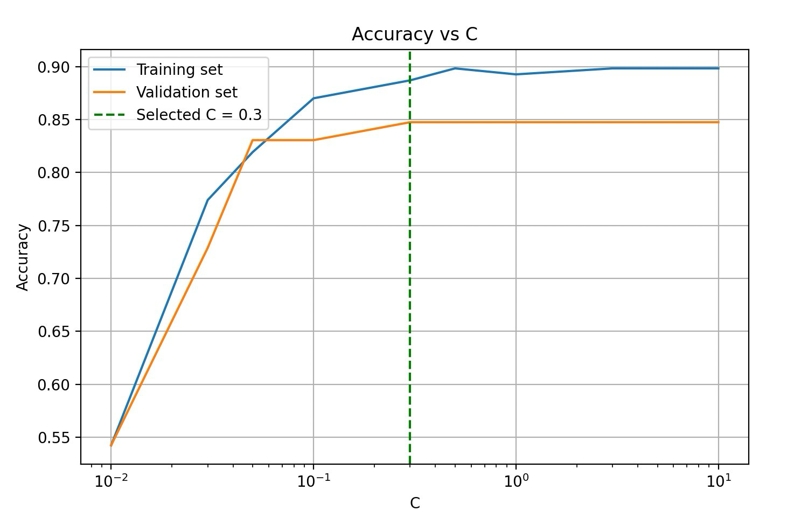

# Heart-Disease Prediction with LASSO Logistic Regression

L1-penalised (LASSO) logistic regression on the UCI Cleveland heart-disease dataset — **0.850 test accuracy, 0.821 recall**, with the penalty identifying which clinical measurements matter most.

Imperial College London, MEng Design Engineering — Year 1 data-science coursework. Group project with Harrick Lee, Joyce Shen and Shivapriya Peram; this repository contains my individual section (logistic regression with LASSO). The group report compared four models on the same cleaned dataset (LASSO logistic regression, decision tree, support vector machine, random forest); only the LASSO section is reproduced here.

## Research question

> Can the presence of heart disease be predicted from routine clinical measurements, and which indicators are the strongest predictors?

## Dataset and cleaning

The data is the UCI Cleveland Heart Disease dataset, obtained through Kaggle (`data/heart.csv`): 1,025 rows with 13 clinical and demographic predictors and a binary target. The raw file needed more care than it first appeared:

- **1,025 → 302 rows** — exact duplicates removed. The Kaggle file upsamples roughly 300 real patients to 1,025 rows; left in place, the duplicates leak identical patients across the train/test boundary and inflate every metric.
- **302 → 296 rows** — records with out-of-range category codes removed (`thal = 0` and `ca = 4` encode missing values).
- **Inverted target fixed** — the 0/1 labels in the raw file are swapped relative to the documentation on Kaggle, so a model trained on it naively predicts the opposite of what the labels claim to mean. The cleaning step swaps them back; after the fix, `target = 1` means disease present (46% of the cleaned records).

`src/prepare_data.py` reproduces this cleaning and writes `data/heart_cleaned.csv`.

## Method

1. **Split** — 60/20/20 stratified train/validation/test split (177/59/60 patients), fixed random seed 42, so the 46% disease rate is preserved in each subset and the split is reproducible.
2. **Standardise** — `StandardScaler` fitted on the training set only, then applied to the validation and test sets. (The L1 penalty depends on coefficient size, so features must be on a common scale.)
3. **Tune** — logistic regression with an L1 penalty (`liblinear` solver), sweeping C from 0.01 to 10 and scoring accuracy and recall on the validation set. Recall matters most here: a false negative (a missed diagnosis) is far costlier than a false positive.
4. **Select and test** — C = 0.3 chosen as the smallest value that performed well on both validation metrics; the final model was refitted at C = 0.3 and evaluated once on the held-back test set.



*Validation accuracy plateaus from C = 0.3 (figure from the report; running the pipeline regenerates the same curve). The companion recall curve is [docs/img/fig2_recall_vs_c.png](docs/img/fig2_recall_vs_c.png).*

## Results

Coursework results are from the group report; the reproduction column is what `src/lasso_pipeline.py` produces when this repository is run end-to-end (Python 3.13, scikit-learn 1.7.2).

| Test set (n = 60) | Report | This repository |
|---|---|---|
| Accuracy  | 0.850 | 0.850 |
| Recall    | 0.821 | 0.821 |
| Precision | 0.852 | 0.852 |

The reproduction matches the report exactly to the three decimal places quoted, including the training set (0.887 accuracy), the validation set (0.847) and the test-set confusion matrix: 23 true positives, 5 false negatives, 4 false positives, 28 true negatives. Test performance sits only slightly below training performance, indicating little overfitting.

### What LASSO kept

The penalty reduced the model from thirteen features to ten, driving the coefficients of `age`, `fbs` (fasting blood sugar) and `restecg` (resting ECG) to zero. Coefficients as reported (the rerun selects the same ten features and matches every coefficient to within 0.01):

| Feature | Coefficient |
|---|---|
| `ca` — major vessels coloured by fluoroscopy | +0.98 |
| `thal` — thallium stress-test result | +0.60 |
| `sex` | +0.59 |
| `oldpeak` — exercise-induced ST depression | +0.36 |
| `trestbps` — resting blood pressure | +0.25 |
| `chol` — serum cholesterol | +0.11 |
| `exang` — exercise-induced angina | +0.11 |
| `slope` — slope of the ST segment | −0.34 |
| `thalach` — maximum heart rate achieved | −0.62 |
| `cp` — chest-pain type | −0.62 |
| `age`, `fbs`, `restecg` | 0 (removed) |

The strongest predictors are consistent with established cardiology: `ca` directly measures arterial narrowing, and a fitter heart reaches a higher maximum rate, so `thalach` lowering predicted risk is expected. The negative `cp` coefficient looks counterintuitive but follows from the dataset's encoding, where the lowest category is typical angina — the chest-pain type most strongly associated with heart disease.

## Limitations

- The test set contains only 60 patients, so the performance estimates carry real uncertainty and could shift with a different split.
- A recall of 0.821 still means roughly one diseased patient in five would be missed — useful as an aid to doctors, but well short of what independent clinical use would require.
- The dataset omits major risk factors such as smoking and family history, which limits how far the findings generalise.

## Repository structure

```
├── data/heart.csv          # raw Kaggle/UCI dataset (1,025 rows)
├── src/prepare_data.py     # cleaning: dedup, out-of-range removal, target fix
├── src/lasso_pipeline.py   # split, scale, tune C, final model + metrics
├── docs/img/               # tuning curves (fig1/fig2 are from the report)
└── requirements.txt
```

`src/lasso_pipeline.py` is transcribed from my code listing in the report appendix, with two minimal adaptations so it runs headless from this repository: the input path, and figures saved to `docs/img/` instead of shown interactively. `src/prepare_data.py` reimplements the cleaning step described in the group methodology.

## Running it

```bash
python3 -m venv venv && source venv/bin/activate
pip install -r requirements.txt
python src/prepare_data.py     # data/heart.csv -> data/heart_cleaned.csv (296 rows)
python src/lasso_pipeline.py   # tuning curves + final test metrics
```

## Acknowledgements

Dataset: [Heart Disease (Cleveland), UCI Machine Learning Repository](https://archive.ics.uci.edu/dataset/45/heart+disease) (Detrano et al.), obtained through Kaggle.

---

Built by Mustafa Suleman — MEng Design Engineering, Imperial College London · [LinkedIn](https://www.linkedin.com/in/mustafaosuleman/)
